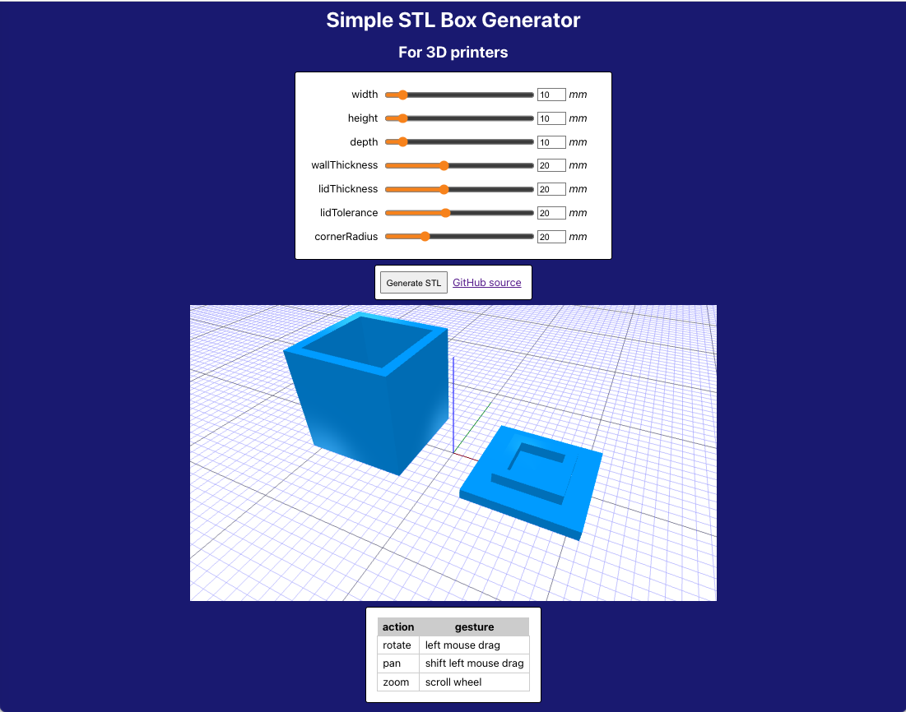

# make 3d printable boxes

Web GUI tool to generate STLs of boxes with lids for 3D printing.

See [the live app here](https://apps.josh.earth/boxbuilder/)



# Using it

Drag the sliders (or type into the number boxes) and the preview updates live. All sizes are in mm.
When it looks right, press **Download STL** to save `box.stl`.

| Setting                | What it does                                                                                    |
| ---------------------- | ----------------------------------------------------------------------------------------------- |
| Width / Depth / Height | Outside size of the box.                                                                        |
| Wall thickness         | Floor thickness. Each side wall is half of this (the cavity is `width − wall thickness` wide).  |
| Lid thickness          | Total thickness of the lid: a flat cap plus a ring that drops into the box.                     |
| Lid tolerance          | Gap between the lid's ring and the box walls. Increase it if the lid is too tight.              |
| Corner radius          | Rounds the four vertical corners of the box and lid. The rim stays flat so the lid seats flush. |

The current settings are saved in the page URL, so you can bookmark or share a box.

**Moving the preview:** drag to rotate, shift-drag to pan, scroll to zoom. On touch screens, drag
with one finger and pinch with two. With the preview focused (click it or Tab to it), arrow keys
rotate, shift+arrows pan, and `+` / `-` zoom.

# How it works

The core of the code is pretty simple.

- It's a React + TypeScript app built with [Vite](https://vite.dev), styled with tooltheme (vendored in `vendor/`).
- The fancy math is done with [JSCad libraries](https://github.com/jscad/OpenJSCAD.org).
- A small [zod](https://zod.dev) schema describes the box; `src/autoform.tsx` turns it into sliders.
- When the model changes, `boxToSolids()` in `src/box.ts` produces JSCad geometry solids. Rounded corners are
  extruded rounded rectangles; each inner outline is an inset of the outer one, so walls stay even around the curves.
- `src/viewer/` renders them with [@jscad/regl-renderer](https://www.npmjs.com/package/@jscad/regl-renderer) (orbit, pan, zoom by mouse, touch or keyboard).
- `solidsToStlBlob()` uses the [JSCad STL serializer](https://www.npmjs.com/package/@jscad/stl-serializer) to generate a binary STL, downloaded as box.stl.
- The current box is saved in the URL, so links and the back button restore it.

# Development

Needs Node 20.19+ or 22.12+.

```sh
npm install
npm run dev          # http://localhost:5173/boxbuilder/
npm test             # vitest
npm run lint         # eslint
npm run typecheck
npm run build        # outputs dist/
```

# tooltheme

The UI uses tooltheme, a classless CSS theme. Its GitHub repo is private, so the package is
vendored as `vendor/joshmarinacci-tooltheme-0.1.0.tgz` and installed from there (this also lets the
deploy server install it without GitHub credentials). To pick up a new version:

```sh
(cd ../tooltheme && npm pack --pack-destination ../boxbuilder/vendor)
npm install ./vendor/joshmarinacci-tooltheme-<version>.tgz
```

Once tooltheme is published to npm, replace the `file:` dependency with the registry version.

`src/App.css` copies tooltheme's app-shell layout rules onto `#root`, because tooltheme's shell
only matches elements directly inside `<body>` and React renders inside `<div id="root">`.

# Deploy

Deployed with pm2 to josh.earth (see `ecosystem.config.cjs`). It's a static site: pm2 checks out
the repo, runs `npm ci && npm run build`, and nginx serves `/projects/boxbuilder/current/dist`
at `/boxbuilder/`.

```sh
pm2 deploy ecosystem.config.cjs production setup   # first time only
pm2 deploy ecosystem.config.cjs production
```
